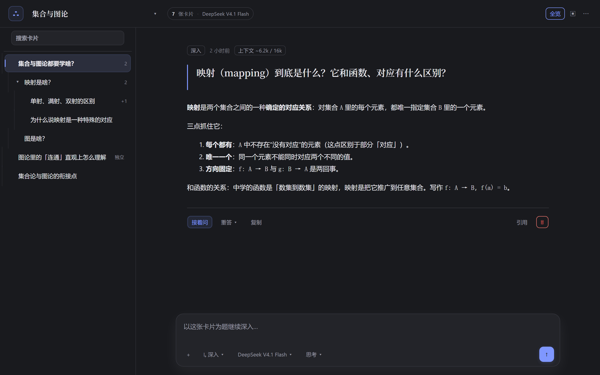
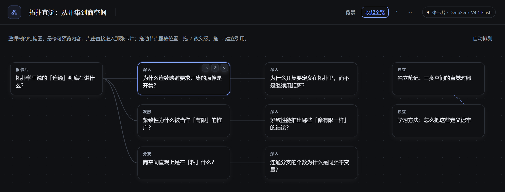

# 卡片树（Card Tree）

把对话长成一棵树：每张卡片是独立成篇的一问一答，可以继续分叉，也可以在全览里直接改这张图。



> 工作台：左栏卡片树，右栏当前卡片，底部输入框按选中的方向生长。样式表渲染的样张，非窗口截图。

## 特性

- **五种生长方式**：深入 / 追问（不新增节点）/ 发散 / 独立，外加「分支重答」；默认深入，方向记住
- **全览即编辑器**：拖节点摆位置、拖 ↗ 改父级（防成环）、拖 ⇢ 建引用虚线、× 删节点或整个分支、一键自动排列
- **上下文按树拼**：只带「根 → 父级」的问答链和被引用的卡片，硬性 token 预算，超了折叠并标出来
- **图片与文件**：`+` 选择或直接 `Ctrl/⌘ + V` 粘贴；模型看不了图就自动换一个能看的
- **只读工具**：卡片能自己调 `read` / `grep` / `web_search` 等只读工具，**不能写文件、跑命令、发消息**
- **可靠**：随时停止（已生成的部分保留并可「继续」）、写盘失败直接报错、每 5 分钟自动备份



> 全览：实线是父子关系，虚线是引用；悬停节点时右上角出现 ↗ 改父级、⇢ 建引用、× 删除。

## 安装

```sh
dsh plugin add dsh-card-tree
```

其它方式（一键脚本 / 手动 / DSH 助手）、更新与卸载见 **[INSTALL.md](INSTALL.md)**。

要求 **DSH 0.2.2-rc.1** 以上，并至少配置一个模型 provider。插件依赖 DSH 的界面座位与服务，
换版本可能失效——失效时面板会显示「运行环境不完整」，而不是一片空白。

## 使用

入口在左侧栏「对话树」图标。第一次打开有「30 秒上手」，之后点顶栏 `?` 再看；想完整走一遍看
**[15 分钟教程](docs/TUTORIAL.md)**。

| 模式 | 语义 | 带上的上下文 |
|---|---|---|
| 深入 | 以这张卡片为题往下一层 | 根 → 父级全部问答 |
| 追问 | 不新增节点，在卡片里接着问 | 祖先链 + 本卡问答 + 已有追问 |
| 发散 | 同层另开一条线 | 同「深入」，与兄弟互不影响 |
| 独立 | 不连到树里的任何卡片 | 只有它自己的问题 |

全览里：拖动摆位｜悬停 ↗ 拖到目标改父级｜⇢ 拖到目标建引用（点虚线删除）｜× 删节点或分支｜「自动排列」回到默认布局。
点节点直接进入那张卡片并关闭全览。回答按 Markdown 渲染（先转义再拼标签）。

更多细节（附件类型、工具白名单、上下文预算、数据恢复、HTTP 接口）：**[docs/USAGE.md](docs/USAGE.md)**。

## 数据与隐私

- 数据都在 `%USERPROFILE%\.dsh\card-tree\`：`state.json` + `attachments/` + `backups/`（30 份滚动备份）
- 卡片内容作为请求发给**你自己配置的模型 provider**；插件本身不联网上传
- 插件路由**没有走 DSH 登录鉴权**：只在本机或可信网络用，别把 `dsh web` 裸暴露到公网
- 只读工具按白名单放行，写文件 / 终端 / 发消息一类工具在调用前就会被拒
- 你本机额外装的只读工具放在数据目录的 `tools.json`，不进源码，也不会随仓库公开

## 开发

```sh
node scripts/verify.mjs   # 语法、元数据、i18n/CSS 审计、宿主逻辑单测，当前 22/22
```

架构、数据模型、HTTP/SSE 合同、座位选择说明：**[docs/ARCHITECTURE.md](docs/ARCHITECTURE.md)**。
客户端半边必须保持单文件（DSH 只加载 `client.js`），可维护性放在宿主侧和自检脚本里。

[MIT](LICENSE) © 2026 Card Tree contributors
