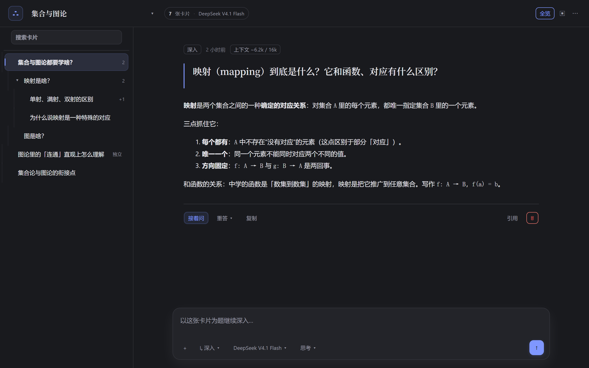

# 15 分钟教程：把一个话题长成一棵树

这份教程不解释全部功能，只带你**完整走一遍**：从一个问题开始，长出分支、在卡片里追问、在结构图上手动编辑器、最后导出备份。走完你就知道它和普通聊天有什么区别了。

> 文中「左边 / 下面 / 顶栏」都指 DSH 里的**对话树面板**本身（左侧栏「对话树」图标打开的那个全局面板），不是 DSH 主对话区。

---

## 第 0 步：打开面板

1. 在左侧栏点 **「对话树」** 图标（树形图标，和「插件」「任务看板」并列）。
2. 中央区域会切换成对话树面板：左边是卡片列表，右边是卡片详情/输入框。

第一次打开会弹一次「30 秒上手」——读完点「开始使用」即可，之后随时点顶栏右上角的 **`?`** 再看。

---

## 第 1 步：建项目，问第一个问题（树根）

1. 点顶栏的项目名旁边 **`▾` → 「新项目」**（或空状态里的「新建项目」）。
2. 在底部输入框输入：`矩阵的特征值到底在描述什么？直观上怎么理解`
3. 按 **Enter** 发送。

你会看到：

- 右侧详情立刻出现这张卡片，答案开始流式生成
- 左侧列表多出第一张卡片，就是这棵树的**根**
- 输入框底部的小胶囊显示 **`↳ 深入`**——它是「下一步往哪长」的方向开关

> 为什么不是普通聊天？普通聊天只有一条线；这里**每张卡片是一个独立结论**，卡片之间靠父子关系组成一张图。

---

## 第 2 步：往下长一层（深入）

1. 在左侧列表选中根卡片。
2. 输入：`那几何上，特征向量为什么在变换后方向不变？`
3. Enter（胶囊仍是「深入」）。

结果：新卡片挂在根**下面**，成为第 2 层。

**关键理解**：生成这张卡片时，模型能看到的上下文 = **从根到它父节点的这条链**（不是整棵树、也不是兄弟分支）。所以每张卡片的答案都能独立阅读，不会出现「如前所述」。

## 第 3 步：从同一个问题另开一支（分支重答 / 发散）

想保留现在的回答，但又想看看换个思路会怎样：

- **分支重答**：选中卡片 → 点卡片下方动作栏的 **「重答 ▾」→「分支重答」**。保留旧答案，从**同一个问题**另开一张同层卡片。
- **发散**：把输入框底的胶囊切到 **`↳ 发散`**。继承到「这张卡片的父级」为止的上下文，在同一层开一条**新的线**（新问题，不是重答）。

两条都会让树从「一条链」变成「一根分叉」——这就是卡片树的形状来源。

## 第 4 步：在一张卡片里刨到底（追问）

选一张卡片 → 胶囊切到 **`↳ 追问`** → 输入 `能不能给一个 2×2 的具体例子？`

- **不会**新增节点，问题会追加在这张卡片的详情里
- 上下文 = 祖先链 + 本卡片问答 + 之前在这张卡里的追问
- 适合：追问细节、要例子、让它自我检查，而**不想让树越长越宽**

## 第 5 步：不连树的独立卡片

胶囊切到 **`↳ 独立`**（或不选任何卡片直接提问也行）→ 新卡片不挂任何父级，也不带上游上下文。适合放「临时想法 / 和这棵树无关的问题」。

## 第 6 步：进「全览」，像思维导图一样手动编辑

点顶栏 **「全览」**，进入结构图。这里可以：

| 操作 | 做法 |
|---|---|
| 摆位置 | 直接**拖节点**；松手即保存到 `state.json` 的 `card.pos` |
| 改父级 | 悬停节点 → 拖右上角 **`↗`** 到目标卡片 → 松手（成环会被拒绝） |
| 加引用 | 悬停节点 → 拖 **`⇢`** 到目标 → 生成**虚线**（只进上下文，不改层级；最多 8 条；一对卡片最多一条） |
| 删引用 | **点一下虚线**，或在卡片详情「引用 · N」里点 `×` |
| 删除节点 / 整条分支 | 悬停节点点 **`×`**，会弹确认（删除会**连带所有子卡片**） |
| 还原布局 | 点顶部「自动排列」 |
| 直接进卡片 | 悬停看预览，**点节点**即进入那张卡片并自动关闭全览 |

> 引用是**单向**的：A 引用 B，只有 A 的上下文会带上 B 的问答；B 不受影响。

## 第 7 步：给它素材（粘贴 / 上传）

在输入框：

- **Ctrl/⌘ + V** 直接粘贴截图或图片
- 或点左下角 **`+`** 选图片 / 文本 / 其它文件（单次最多 6 个，单个 ≤ 12 MB）

图片会交给视觉模型；如果当前模型看不了图，宿主会自动换一个能看的并在面板顶部提示。文本类文件（txt/md/csv/代码）会内联进上下文；其它二进制按文件块发。

## 第 8 步：备份、换机、清场

- **导出**：顶栏 `⋯` →「导出项目 JSON」下载整个项目
- **导入**：`⋯` →「导入项目 JSON」，选择刚导出的文件
- **撤销删除**：删项目后底部会出现「已删除 xxx · 撤销」，误删可以立刻恢复
- **数据在哪**：`%USERPROFILE%\.dsh\card-tree\`（`state.json` + `backups/` 自动快照 + `attachments/` 附件）。换机器时连同整个目录一起复制即可。

## 第 9 步：几个值得知道的行为

1. **上下文 = 祖先链 + 引用 + 本卡追问**，不含兄弟/后代/其它分支——这是它「卡片可独立成立」的原因。
2. **上下文有预算**：卡片多、答案长时会自动折叠老答案（详情页有「上下文 ~Xk/Yk · N 已折叠」徽标），不会撑爆模型窗口。
3. **模型 / 思考程度**：底部输入框右侧可以按项目选模型与推理档位，`⋯` 里可设为项目级。
4. **只读工具**：卡片可以调用 read/glob/grep/web 等只读工具和本机 `tools.json` 里配置的插件工具（如微信读书/哔哩哔哩读取），写文件、跑命令、发消息一律被拒。
5. **生成可以停**：运行中点「停止」，已生成的部分会保留为「生成中断」，可以点「继续」接着写。

## 第 10 步：遇到问题

| 现象 | 原因 / 处理 |
|---|---|
| 「运行环境不完整」横幅 | DSH 升级后座位改名，插件需要更新；点「重新检查」确认 |
| 提示「没有可用的默认模型」 | DSH 里还没配 provider，先在 DSH 设置里配好 |
| 图片发出去被换模型 | 当前模型不支持图片，宿主自动换成支持视觉的模型（顶部会提示） |
| 面板里看不到树 | 左侧栏图标打开；或窗口太窄，用顶栏的「卡片/列表」切换按钮 |
| 没有侧栏图标 | 插件没装好：看 [INSTALL.md](../INSTALL.md) |

---

## 想只记三件事

1. 选卡片 + Enter ＝ 往下长一层（深入）
2. 胶囊换方向：追问（同卡内）、发散（同层新线）、独立（不连树）
3. 「全览」是这棵树的编辑器：拖动、改父级、加引用、删分支

其余细节见 [USAGE.md](USAGE.md)，内部结构见 [ARCHITECTURE.md](ARCHITECTURE.md)。
